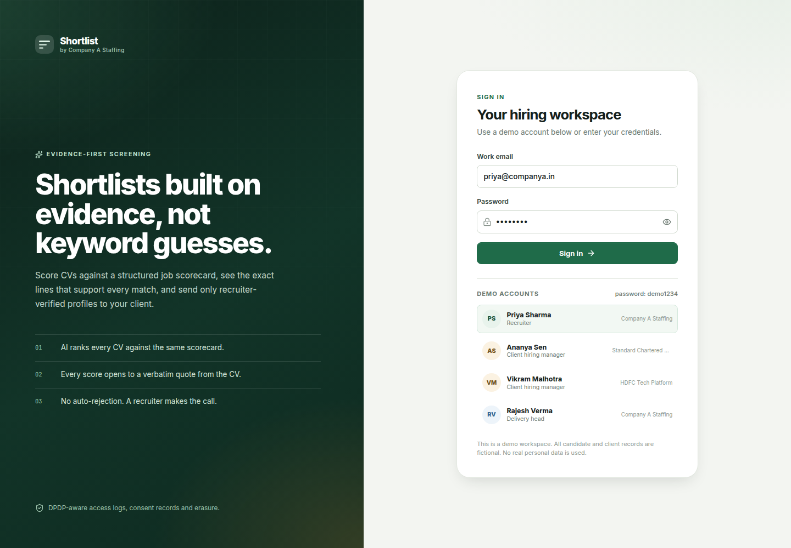
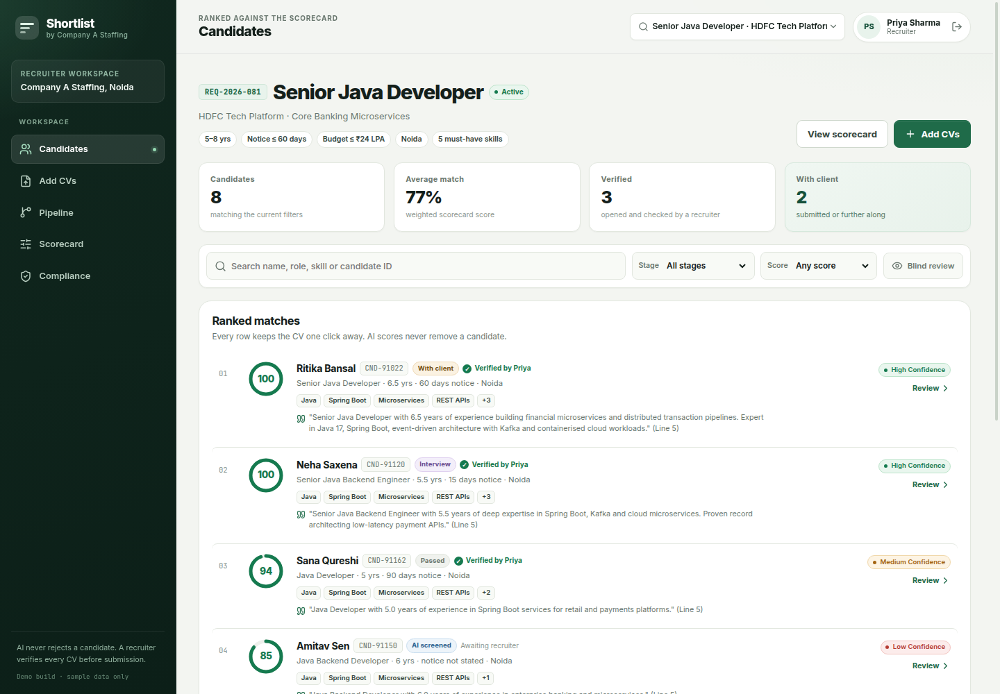
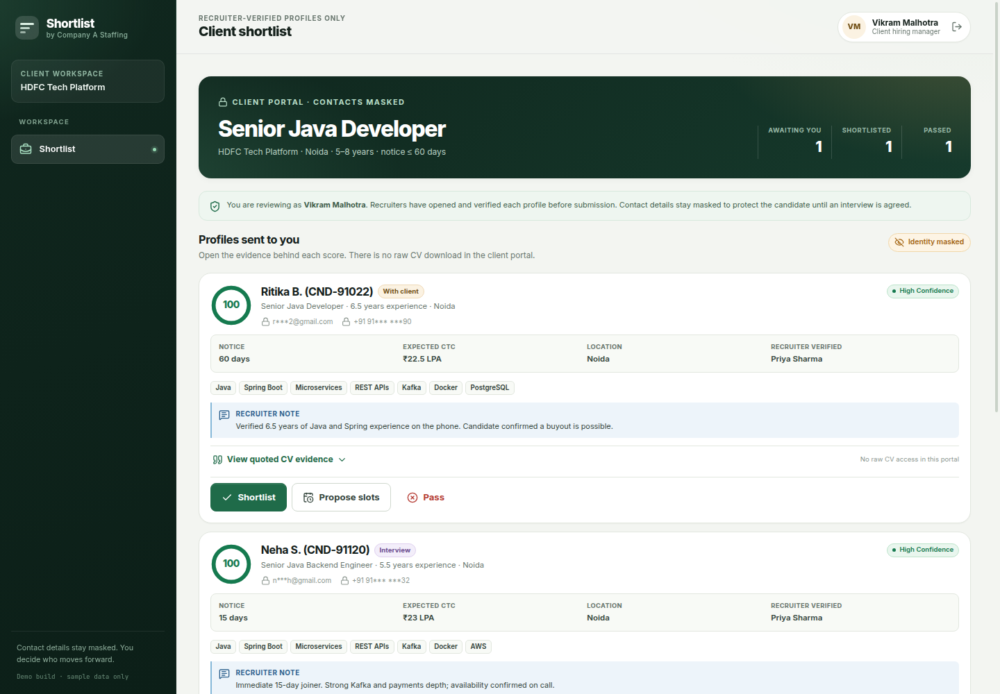

# Shortlist

### AI-assisted resume screening and client shortlist portal

A working full-stack prototype built for the Company A Staffing brief: turn a job description into a scorecard, screen CVs in bulk, keep every score backed by evidence, and give clients a clean shortlist portal without exposing candidate contact details.

Demo build only. Every candidate, client and CV in the seed data is fictional. No live deployment, customer adoption or performance result is claimed.



## What it does

1. A recruiter turns a job description into an editable scorecard.
2. CVs are uploaded in bulk (PDF, DOCX or TXT), parsed, deduplicated and scored.
3. Matched criteria carry a verbatim CV quote and line number; missing evidence is called out explicitly, with a confidence level.
4. A recruiter must open the CV and explicitly verify it before it can be submitted.
5. The client sees only recruiter-verified profiles, with names, emails and phones masked.
6. The client can shortlist, pass with a reason, or propose interview slots.
7. CV opens, verification, stage changes, client decisions and erasure are written to an audit log.

Nothing is auto-rejected. Low scorers stay in the ranked list and remain searchable.

## Why the workflow is trustworthy

- **Evidence over vibes.** Scoring is deterministic matching against the scorecard. Every criterion shows the quote it matched, or says that the evidence is missing.
- **Uncertainty is explicit.** Missing notice periods, missing CTC and below-band experience are flagged with low confidence instead of being guessed or treated as rejection reasons.
- **A human gate before the client.** `POST /api/candidates/:id/verify` rejects the request unless that recruiter has a recorded `view_unmasked_cv` audit event for that candidate and requisition.
- **Clients cannot browse the database.** Client routes are scoped to the client's own requisitions, return masked contacts, and never return raw CV text.
- **Deletion means deletion.** Erasure clears the CV text, direct identifiers and derived profile fields, clears evaluation evidence, and keeps only the audit trail and purge receipt.
- **No invented metrics.** The insights screen reports real counts from the database. Any future ROI or time-saving claim should come from a measured pilot, not a dashboard placeholder.

## Quick start

Requirements: Node.js 22+, npm 9+, and Chrome if you want to rebuild the TDD PDF.

```bash
git clone <public-repository-url>
cd isocode-assing

npm install
npm --prefix backend install
npm --prefix frontend install

npm test
npm run dev
```

Open `http://localhost:5173`.

The SQLite database is created and seeded automatically on first boot. To run the production build instead:

```bash
npm run build
npm start
# http://localhost:4000
```

With Docker:

```bash
docker compose up --build
# http://localhost:4000
```

See [`deployment.md`](deployment.md) for the full runbook, environment variables and production notes.

## Demo accounts

All seeded accounts use the password **`demo1234`**. The sign-in screen lists them; passwords are never returned by the API.

| Role | Name | Email | Scope |
| --- | --- | --- | --- |
| Recruiter | Priya Sharma | `priya@companya.in` | Company A workspace |
| Client hiring manager | Vikram Malhotra | `vikram@hdfctech.com` | HDFC Tech Platform only |
| Client hiring manager | Ananya Sen | `ananya@standardchartered.com` | Standard Chartered only |
| Delivery head | Rajesh Verma | `rajesh@companya.in` | Internal workspace, calibration, demo reset |

The delivery-head account can restore the demo dataset from the Insights screen. This is a demo convenience, not production administration.

## Screens

| Recruiter workspace | Client shortlist |
| --- | --- |
|  |  |

The client portal is deliberately narrower than the recruiter workspace: evidence and recruiter notes are visible, raw CVs and contact details are not.

## How the main pieces fit

```
React 19 + Vite 8 SPA
        │  HttpOnly session cookie
        ▼
Express 5 API
  auth → role guard → tenant guard
  auth · requisitions · candidates · pipeline · client · dpdp · analytics
        ▼
SQLite (better-sqlite3, WAL)
  users · sessions · requisitions · candidates
  cv_evaluations · access_audit_logs · calibration_audits
```

- **Frontend:** React 19, TypeScript, Vite 8, custom responsive CSS.
- **Backend:** Node.js 22, TypeScript 7, Express 5; compiled with `tsc` to `backend/dist`.
- **Database:** SQLite with WAL mode; the schema is created on boot and seeded when empty.
- **Auth:** `scrypt` password hashes, random session tokens stored as SHA-256 hashes, HttpOnly `shortlist_session` cookie.
- **Parsing:** `pdf-parse` and `mammoth`; uploads stay in memory and are never written to disk.
- **Scoring:** local deterministic evidence matcher. An optional LLM is used only for JD-to-scorecard intake, with a deterministic fallback.
- **Tests:** Node's test runner and Supertest, run through `tsx`; 26 backend tests.

## Testing

```bash
npm test
```

The suite uses a disposable `backend/data/test-screening.db` and covers PDF text extraction, parsing, evidence quoting, uncertainty, blind screening, PII masking, deduplication, auth cookies, rate limiting, role and tenant boundaries, the CV-view verification gate, scorecard validation, bulk upload, client decisions, and DPDP erasure.

Manual checks against the running app covered sign-in for every role, scorecard re-scoring, a three-CV upload, verification and submission, client shortlist/pass/slot flows, erasure, and desktop/mobile layouts.

## Limitations

This is a credible core slice, not a production ATS.

- Heuristic CV parsing and exact-word skill matching; no OCR, semantic search or trained ranking model.
- SQLite and an in-memory login limiter are single-instance choices.
- Client contact masking is a product control, not encryption.
- Consent capture is recorded in the demo; there is no candidate-facing consent or withdrawal journey.
- No email/calendar integrations, background queue, MFA, SSO or malware scanning.
- Audit logs are append-only by application convention, not database permissions.
- No automated browser test suite; manual CDP checks were used during development.

The Technical Design Document discusses these trade-offs and the production path in more detail.

## Submission artifacts

- [`docs/TDD.pdf`](docs/TDD.pdf) — the Technical Design Document.
- [`deployment.md`](deployment.md) — local, Docker and production deployment guide.

Rebuild both submission files with:

```bash
npm run package-zip
```

This regenerates `docs/TDD.pdf` from [`docs/TDD.md`](docs/TDD.md) using headless Chrome, then creates `submission.zip` containing only `TDD.pdf` and `deployment.md`.

## License

MIT. See [`LICENSE`](LICENSE).
